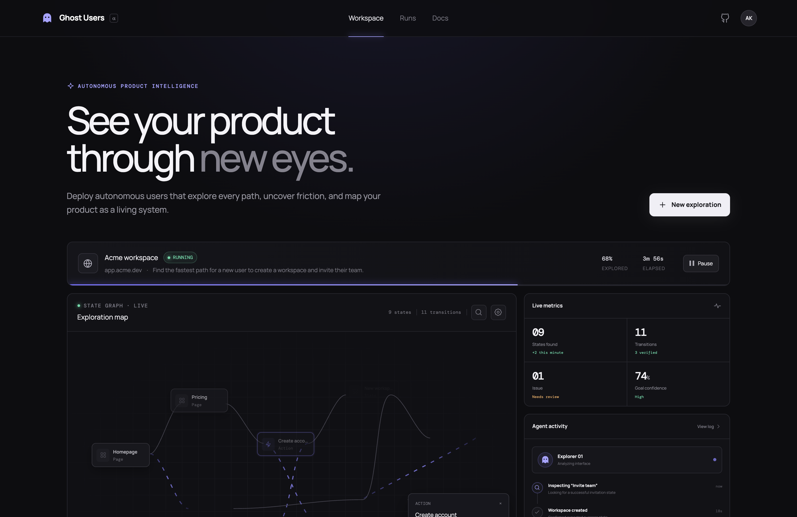
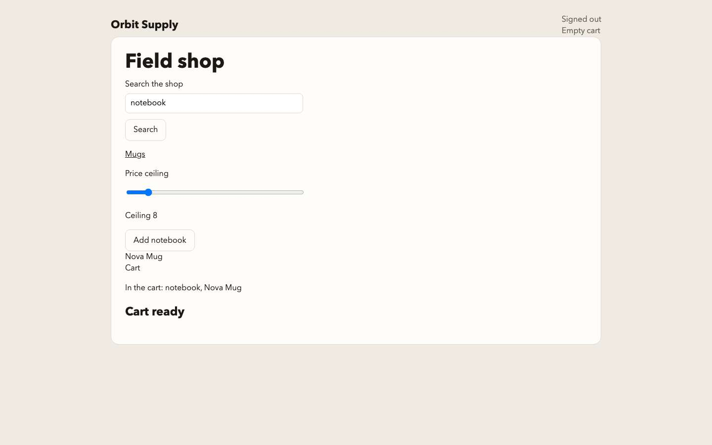

# C12 | Show the Figma file

Source: Codex

Conversation ID: 01a1b77e-0f3d-71d2-8155-588acca8bf56

Coverage: all user/assistant messages returned by the reader; no older-page cursor was supplied.

## Turn 1 | Nov 07, 2026, 02:30:54 PM EST

### You | C12.T01.M01

examine the figma in the folder, show it to me

### Assistant | C12.T01.M02

I’ll find the Figma file in the project folder and open a preview.

### Assistant | C12.T01.M03

Found [ghost-users.fig](/Users/nicholasmino/ProgrammingFiles/Hackathons/NOVA2026/ghost-users.fig). It shows a dark dashboard with purple accents, an exploration map, live metrics, and agent activity.

Here’s the full-resolution preview saved inside the file:

## Turn 2 | Nov 07, 2026, 02:41:12 PM EST

### You | C12.T02.M01

Run and examine the current system, does it have everything I asked for

### Assistant | C12.T02.M02

I’ll run the current app, check its main flows, and compare what works against the project requirements and Figma design.

### Assistant | C12.T02.M03

The local services are running, and the interface builds. I’ve found some meaningful gaps already: the new dashboard hides much of the evidence and replay detail, and several later-stage features are narrower than the project brief describes. I’m checking those in the browser while the automated checks finish.

### Assistant | C12.T02.M04

All 25 automated checks passed. A fresh model-guided Orbit run also passed an independent replay in 6 interactions, taking about 17 seconds.

I confirmed a result-labeling bug in the browser: the Express test correctly fails in the backend, but the dashboard still shows “1 verified” and “1 Verified steps.” The Provider screen can test an endpoint, but cannot save or select it for an investigation.

### Assistant | C12.T02.M05

The comparison also failed twice: Harbor passed, while Orbit’s reused comparison cart contained two mugs. I also confirmed that an invalidated result can still be returned as the “best verified” route.

New browser-action code appeared on disk during the audit. I’m checking that revision separately so the final assessment distinguishes it from the already-running server.

### Assistant | C12.T02.M06

The updated code now passes 26 checks. Its new search, typing, slider, and drag actions also completed a real model-guided run and fresh replay in 6 steps.

That confirms those actions work in the ordinary investigation path. The remaining gaps are in how features are connected and presented: evidence access, trustworthy result labels, provider selection, review controls, and repeatable comparisons.

### Assistant | C12.T02.M07

**No. The core investigation works, but the app does not yet satisfy the full project brief.**

I ran the app and browser flows, checked the Figma layout, and verified:

- **26 automated checks passed**, and the frontend builds.
- A real model-guided Orbit investigation passed independent replay in **6 interactions**.
- The new search, typing, slider, and drag flow also passed replay in **6 interactions**.
- Express correctly failed; its fixed-build retest passed.

The main gaps are:

| Area | What’s missing or broken |
|---|---|
| Evidence inspection | Screenshots, traces, detailed checks, and witness steps are disconnected from the dashboard. Playback has no navigation link. |
| Result accuracy | A failed Express run displays **“1 verified.”** “100% explored” is calculated from completion rather than measured coverage. [Source](/Users/nicholasmino/ProgrammingFiles/Hackathons/NOVA2026/frontend/src/components/WorkspaceScreen.tsx:76) |
| Stale results | Invalidating a verification still leaves it returned as the **best verified** route. I reproduced this. [Source](/Users/nicholasmino/ProgrammingFiles/Hackathons/NOVA2026/backend/ghost/store/projections.py:87) |
| Adaptive mode | The search-and-drag task passed in ordinary mode but stopped without a result in the default adaptive mode. The new actions aren’t fully connected there. |
| Model configuration | Provider testing works, but the interface cannot save or select that endpoint/model for investigations. |
| Review workflow | Recommendation editing, accepting/rejecting, and before/after inspection are missing. “Export brief” displays text rather than downloading it. Recommendations always use the same Express diagnosis. |
| Comparison | A fresh comparison passed once, then failed on repetition because Orbit’s comparison cart wasn’t reset. [Source](/Users/nicholasmino/ProgrammingFiles/Hackathons/NOVA2026/backend/ghost/engine/compare.py:9) |

The dashboard resembles the Figma, but its inspection features remain incomplete. The documented efficiency pilot and demo recording are also unfinished.

I left the [tested app open here](http://127.0.0.1:8877/runs/run_22109210ab2647fa). Files were being edited during the audit, so these findings describe the instances I tested.

Actual browser evidence from the successful search-and-drag run:

## Turn 3 | Nov 07, 2026, 02:51:18 PM EST

### You | C12.T03.M01

it keeps reporting that its done, but it has amost none of the features I told it to do, why

Write a prompt to add everything else

### Assistant | C12.T03.M02

It appears to be treating narrow tests and demo endpoints as proof that whole features are finished. The tests pass, but they don’t cover much of the user-facing workflow. I’ll write a prompt that makes completion depend on working screens, connected behavior, and evidence against your requirements.

### Assistant | C12.T03.M03

It’s counting **implemented pieces as completed features**. A passing test for a scripted demo doesn’t prove the feature works through the interface. The project also permits stopping at an accepted stage, which makes it easier to report a narrow checkpoint as “done.”

The prompt needs to remove that ambiguity and require evidence for every requested capability. Paste this into the implementing agent:

Finish Ghost Users against my complete requirements. Stop reporting the product as done when only individual components, scripted demos, or backend endpoints work.

Work in:
`/Users/nicholasmino/ProgrammingFiles/Hackathons/NOVA2026`

This is an implementation request. Inspect the current source, implement the missing functionality, run the actual application, test the user-facing workflows, and repair failures. A plan or another list of claimed features is not the deliverable.

1. Establish the full scope before coding

Read:
- `AGENTS.md`
- `CURSOR_GOAL_PROMPT.md`
- `GHOST_USERS_CURSOR_EXECUTION_BRIEF.md`
- `ASTRA_GOAL_PROMPT.md`
- `NOVA_PROJECT_PLAN.md`
- `docs/contracts.md`
- `docs/ui.md`
- `docs/continuation.md`
- The current frontend, backend, tests, and local `ghost-users.fig`.

Use my latest instructions to resolve conflicts. This request authorizes completing the remaining R01–R08 scope; old timeboxes, today’s deadline, and the old R01-only implementation target do not reduce that scope. Preserve stage acceptance gates and keep unfinished capabilities out of released navigation. Update stale coordination instructions and status records to reflect this request.

Search live roots using `scripts/live-search`. Do not use frozen `releases/` directories as implementation source. Read `release-index.json` only for labels and status.

Preserve unrelated changes. Check for other processes or agents modifying this checkout. Establish which source version each running server actually loaded, and avoid testing an old process while claiming to have verified new code.

Create a requirements checklist that maps every original requirement to:
- Its actual user-facing behavior.
- Frontend and backend implementation.
- Verification method.
- Evidence.
- Status: missing, partial, verified, or blocked.

Do not mark something verified because a file, endpoint, component, or passing unit test exists. Never silently remove requirements from this checklist.

2. Restore the complete investigation and evidence experience

The dashboard must support investigating and inspecting real runs, not just displaying an attractive graph.

Connect the existing evidence inspector and complete it. From the normal run screen, users must be able to inspect:
- Exact chronological actions and their primitive costs.
- Selected actions and the reasons for them.
- Before/after screenshots and browser traces.
- Initial, invariant, terminal, and stability checks, including failure details.
- Best verified route separately from candidates and failed attempts.
- Goal, starting conditions, task/build/model/prompt identities.
- Budget, actual usage, elapsed time, accounting limitations, and stop reason.
- Adaptive scheduling, deferral, exclusion, and reactivation explanations.

Make recorded playback discoverable from the run library and run details. Provide clear controls for recorded playback versus a new independent verification. Playback must remain read-only and must not trigger browser or model work.

Implement graph zoom/fit, accessible route inspection, stable positions consistent with the contract, and usable large-graph behavior. On narrow screens, provide a readable witness list and evidence drawer instead of an unreadable miniature graph.

Use the local Figma as the current visual reference. Preserve its visual direction while fitting these functional requirements. Inspect the actual app at desktop and narrow widths; fix clipping, overflow, unreadable graph labels, excessive hero space, and inaccessible controls.

3. Correct misleading results and stale verification

Fix these reproduced defects:

- A failed Express replay must not appear as “1 verified” or “1 Verified steps.”
- A passed run must not imply “100% of the application explored.” Remove the percentage unless there is a defensible coverage denominator. Otherwise show a truthful action, budget, or run-status indicator.
- A stale or invalidated verification must not remain the current best verified result.
- Stale verifications must not continue coloring affected graph nodes as currently verified.
- Exclusions depending on invalidated incumbents must be reconsidered.
- A failed or inconclusive check must not become a success through fallback values.

Keep historical outcomes available with their original build scope, clearly distinguished from current validity.

Add meaningful regression checks covering the API projection and what the interface actually displays.

4. Complete general browser tasks, shopping, and personas

Finish the new browser-action work across ordinary investigation, adaptive investigation, restoration, frozen replay, accounting, evidence, and UI configuration. Do not implement actions in only one execution path.

The ordinary path has demonstrated typing, slider dragging, and item dragging. The same task stopped without a result in adaptive mode. Investigate and fix that integration gap.

Support the actions needed by the requested tasks: searching and filling inputs, navigation, relevant form controls, scrolling, keyboard interaction, sliders, and drag/drop. Represent action data explicitly and replay the exact frozen actions without silently changing their meaning.

Expose task, persona, supplied data/search queries, constraints, and relevant action settings in the setup interface. Ensure accepted configuration is actually passed to the runner. Fix the mismatch where three search queries can be accepted but only two are offered.

Implement the complete shopping task described in `SHOP_TASK`:
- Notebook, ballpoint pen, and ceramic mug.
- Choose cheaper eligible options when alternatives are visible.
- Search for the notebook.
- Reach the pen or mug through department/category navigation.
- Adjust a price slider when present.
- Inspect the resulting cart.
- Do not sign in or place an order.

The current two-item toy shop does not establish that this three-item task is complete. Extend the controlled fixture to exercise the full task, including meaningful alternatives and prices.

Make the price, browse, search, careful, and hurried personas selectable and operational. Each must preserve the common task requirements. Fix the browse persona’s blanket ban on filling fields when its own instructions allow the required notebook search.

Verify task success and applicable behavioral constraints using explicit evidence and trustworthy checks. A visible “Cart ready” heading alone does not establish the correct items, quantity, price choice, navigation behavior, or persona compliance.

Use actual model-selected actions for discovery demonstrations. Scripted actions are valid for clearly labeled regression tests, not proof of autonomous discovery or persona behavior.

For supplied applications, support legitimate navigation to different URL paths. Declare restoration and evaluator limits accurately. Report unavailable or inconclusive results when conditions cannot be established.

5. Complete adaptive investigation and efficiency

Implement the original R02 and R04 requirements, including:
- Bounded frontier and exact witnessed histories.
- Relevance scheduling with fairness.
- Safe prefix exclusion using valid bounds and a current verified incumbent.
- Reactivation when dependencies or incumbents become invalid.
- Eligibility for cheaper arrivals.
- Protection against combining incompatible histories into an invented route.
- Visible decision explanations linked to evidence.

Connect the new action types and persona configuration throughout adaptive search.

Replace weak exact-work keys with the required task/check/action-policy/app/environment versions, initial-state scope, exact history, action/data identity, observation revision, purpose, and prompt version.

Implement checked reuse with current preconditions, fresh targets, invariant checks, invalidation, and correct browser/model usage charges. Independent verification must remain real, separately accounted work.

Run the measured efficiency and prompt-evaluation work required by the original brief. Preserve raw runs, failures, held-out cases, sample sizes, policy/prompt versions, and cold/warm conditions. Do not claim savings from deduplication code or graph animation.

6. Finish findings, review, brief export, and retesting

Replace the hardcoded Express recommendation generator with evidence-grounded reasoning applicable to the actual failed task. Unrelated failures must not receive an invented Express/cart-race diagnosis.

Provide a connected workflow from a finding to:
- Observation, supported claim, impact hypothesis, evidence, and unknowns.
- Editable recommendation and acceptance conditions.
- Persisted edits, rejection, and acceptance for export.
- A real downloadable Markdown brief.
- Explicit selection of the changed build and readiness for retest.
- A linked retest result and understandable before/after comparison.

Keep task, action sequence, initial conditions, invariants, goal checks, and stability criteria comparable. Use the real stored “before” task and verification. Missing or invalid before-run identifiers must never produce a fabricated comparable result.

Implement the original product screenshot/UI-review feature and persist its observation bundle, structured advice, evidence references, prompt/build identities, and usage.

Runtime recommendations and briefs do not authorize repository edits.

7. Finish equivalent application comparison

Fix the reproduced comparison failure: a fresh comparison passed, but repeating it failed because Orbit reused a cart containing two mugs.

Each comparison must establish fresh, independently isolated initial conditions. Verify both applications using their actual acceptance conditions and independent frozen replays.

Persist both runs with their own graphs, witnesses, checks, evidence, usage, and build identities. Make each side inspectable from the comparison screen.

Provide task/application selection and a visible comparability explanation. Check equivalent product, quantity, account state, terminal milestone, viewport, action policy, and resource caps. Show non-comparability or unavailability explicitly.

A pair of hardcoded route scripts and enabled buttons is insufficient.

8. Finish provider portability, keyboard objectives, and workers

Provider configuration:
- Test, save, select, and reuse endpoint/model settings from the interface.
- Ensure investigations use the selected configuration.
- Remove hardcoded `echo-local` selection from real configurable investigations.
- Label the deterministic echo fixture honestly.
- Demonstrate a completed investigation through the selected actual provider.
- Record observed model identity, usage, latency, supported capabilities, and failures.
- Keep credentials server-side and scoped to their intended destinations.

Keyboard objectives:
- Enforce an explicit keyboard-only action policy.
- Record focus and key actions with their costs.
- Independently replay the same keyboard actions.
- Do not treat one predetermined focus/Enter execution as general keyboard support.
- Provide objective selection, evidence, stale indicators, and revalidation history.

Durability and workers:
- Complete history search/export, restart/reconnect behavior, migrations, and dependency-aware invalidation.
- Implement the original R08 isolation, leases, worker attribution, cancellation, crash recovery, duplicate avoidance, and budget conservation requirements.
- Protect investigations from global fixture-build changes during another run’s retest.
- Verify concurrent behavior with adversarial tests.
- Do not equate a two-run semaphore with completion of the worker requirements.

9. Verify completion through the product

For each checklist item:
- Implement frontend, backend, persistence, and failure states.
- Run a meaningful independent check.
- Exercise the feature through the actual interface.
- Inspect the resulting evidence.
- Repair failures before marking the item verified.

Include end-to-end checks for:
- Successful and failed investigations.
- Evidence and trace access.
- Recorded playback and fresh replay.
- Stop and budget exhaustion.
- Reload/reconnect and process restart.
- Stale-result invalidation.
- Repeated comparisons.
- Provider selection actually affecting a run.
- Recommendation edit/reject/accept/export.
- Comparable and non-comparable retests.
- Shopping/persona tasks through ordinary and adaptive execution.
- Keyboard-only frozen replay.
- Concurrent isolation and recovery.

Keep OpenRouter limited to product reasoning. Never send repository source, patches, or code-generation requests to it.

Complete the required portable setup, documentation, release evidence, deck exports, and recording handoff. Distinguish recording instructions from an actual recorded video. Never fabricate missing deliverables.

Do not weaken checks, hardcode discovery paths, substitute fixtures for claimed real-model demonstrations, or mark unsupported behavior passed to make the checklist green.

Continue implementing within the available session. If a hard limit or external dependency prevents completion, leave an accurate checkpoint identifying exactly what remains. Partial progress must be reported as partial progress.

Your final response must include:
- The completed requirements checklist with evidence links.
- Exact running-app URL and tested source identity.
- Actual end-to-end results, including negative outcomes.
- Screenshots of the final working interface.
- Remaining incomplete or blocked requirements.
- Whether the entire requested scope is complete.

Only report the whole product as done when every mandatory requirement is verified. Passing the existing test suite is necessary, but it is not the definition of completion.

Begin now.

## Turn 4 | Nov 07, 2026, 03:28:19 PM EST

### You | C12.T04.M01

examine now, It still doesnt ahve the agent interface I talked about to start making a plan/request, I cant see it do anything or give any advice

### Assistant | C12.T04.M02

I’ll check the current app for the agent conversation flow: making a request, reviewing its plan, watching it work, and getting advice from the results.

### Assistant | C12.T04.M03

The missing flow is real: the app still starts with a setup form, and “Agent activity” is a status log rather than a place to talk to the agent. I also found that the tab I left open earlier was an older audit instance. I’m checking the latest interface too; the current source has more controls, but no conversational request-and-plan interface.

### Assistant | C12.T04.M04

**You’re right—the agent interface you described is still missing.** I checked the latest app at [localhost:5173](http://localhost:5173/), not just the older audit instance on port 8877.

What exists now:

- A setup wizard for entering a URL and objective.
- Activity logs, recorded screenshots, and an evidence inspector.
- A separate Review form that requires a failed run ID.

What’s missing is the main interaction: **describe a request → discuss a plan → watch execution → receive advice → ask follow-up questions.** There is no conversation interface or connected planning session.

The backend does perform actions. I inspected a current Amazon run: it made 6 model requests and 11 browser actions, then failed independent replay because a target was missing or blocked. The app exposes that as technical status rather than explaining what happened and offering useful next steps.

My previous prompt did not make this primary interaction explicit enough. Put this instruction **before** the broader completion prompt:

Build the missing conversational agent workspace first. This is the primary product experience, and it takes priority over additional demo fixtures, benchmarks, decks, and release packaging.

The current wizard, graph, activity log, and recommendation form do not satisfy this requirement.

The required experience is:

1. I describe what I want.
2. The agent helps turn it into a concrete investigation plan.
3. I review or revise that plan and start execution.
4. I watch what the agent is doing.
5. It explains the results and gives evidence-backed advice.
6. I ask follow-up questions or request another investigation in the same conversation.

Implement that complete flow.

REQUEST AND PLANNING

Make a prominent conversation composer the starting point. Accept a website URL and a plain-language request, for example:

“Watch five different shoppers try to buy a notebook, pen, and mug. Find where they struggle and recommend improvements.”

Use the configured reasoning model to interpret the request. Ask only necessary clarifying questions. Produce a visible, editable plan covering the objective, scenarios/personas, constraints, starting conditions, success checks, budget, and expected outputs.

Users must not need to invent evaluator IDs, target-heading names, policy IDs, or run IDs to make an ordinary request.

Support plan revisions in the conversation. Show clearly when a plan is ready and provide a Run plan control. Persist the accepted plan and its connection to the resulting runs.

VISIBLE EXECUTION

Keep the conversation visible while the investigation runs. Show:
- The current scenario/persona and task.
- Short explanations of the next action.
- Actual actions and observed outcomes.
- An automatically updating browser view or frequent captured screenshots with capture timestamps.
- Progress through the accepted plan.
- Usage and remaining budget.
- Accurate queued, running, waiting, blocked, verifying, stopped, and completed states.

Connect these displays to actual persisted execution events. Do not animate invented activity or display a queued run as actively working.

Provide Stop and follow-up controls. Explain whether a follow-up will answer from existing evidence, revise pending work, or start a new run. Never pretend an instruction changed work that already finished.

ADVICE AND FOLLOW-UP

Automatically return a readable answer when execution finishes, fails, or becomes blocked. Explain:
- What was attempted and actually observed.
- Which goals passed, failed, or remain uncertain.
- Where users encountered friction.
- Specific recommended improvements and their supporting evidence.
- Useful next steps and what should be tested again.

Generate advice using the configured reasoning model and the recorded observations. Validate evidence references and distinguish observations from hypotheses. Never infer broad product conclusions from a CAPTCHA, infrastructure failure, or one unsuccessful route.

Allow questions such as “Why did that fail?”, “Show me the evidence,” “Which shopper struggled most?”, and “Test this revised flow.” Preserve conversation context and link each answer to the relevant plan, run, and evidence.

INTEGRATION AND ACCEPTANCE

Reuse the existing runner, event stream, evidence store, provider configuration, and verification system. Preserve the Figma visual direction while making the conversation and visible browser work central.

Persist conversations, messages, plan revisions, and run links across refresh and restart.

Verify this through the actual interface: submit a new natural-language request, revise its plan, launch it, observe real browser work, receive supported advice, ask a follow-up, and reload the conversation.

Also test failure and blocked states. Confirm that errors produce useful explanations and next steps.

Do not report this feature complete based on endpoints, scripted tests, or screenshots alone. Demonstrate the entire interaction through the running app and provide its URL.

Implement this first, then continue the remaining requirements from the broader completion prompt.

## Turn 5 | Nov 07, 2026, 03:34:08 PM EST

### You | C12.T05.M01

there are no personad agents like I wanted, no feedback, ... this should give in depth actionalable feedback

### Assistant | C12.T05.M02

**The persona agents and actionable feedback are central to the product.** In the version I examined, personas were largely instructions passed into a shared runner, and advice was basic failure text. My earlier checks established browser mechanics; they did not establish the experience you wanted.

Use this revised prompt to make those the immediate priority:

Build Ghost Users around its core purpose: multiple persona agents investigate a product and return detailed, evidence-backed, actionable feedback.

The required experience is:
Describe a request → collaborate on a plan → launch persona agents → watch their individual investigations → receive substantial recommendations → ask follow-up questions and retest.

Prioritize this complete experience before further benchmarks, release packaging, decks, or additional fixture demonstrations.

1. Make the agent conversation the starting point

Provide a prominent composer where I enter a URL and describe what I want investigated.

The agent should help refine the request, ask necessary clarifying questions, and propose an editable investigation plan. The plan must identify the task, personas, starting conditions, constraints, success criteria, and budget.

I must be able to revise the plan conversationally and launch it from that conversation. Do not require me to manually supply run IDs, evaluator IDs, or target-heading names.

2. Implement substantive persona agents

A persona dropdown or a paragraph appended to a prompt is not sufficient.

Each persona must have its own:
- Explicit behavioral profile and investigation priorities.
- Browser context and appropriately isolated application state.
- Task context, action history, observations, and evidence.
- Brief decision explanations and progress.
- Outcome, difficulties, and findings.

Provide editable profiles such as:
- Price-conscious shopper: compares eligible prices and investigates affordability.
- Exploratory shopper: uses categories and navigation to discover options.
- Search-focused shopper: relies on search, terminology, and filtering.
- Careful shopper: inspects details, uncertainty, and confirmation before committing.
- Hurried shopper: pursues a short, understandable route and exposes unnecessary effort.

Personas must make model-guided decisions from actual observations. Their profiles should influence choices without overriding the shared task constraints. Do not force different routes or invent differences to make the demonstration interesting.

Let me choose, edit, add, and remove personas before launch. Explain which behaviors the system can actually test and which remain uncertain.

3. Let me watch each agent work

Provide an agent roster with individual status, current task, latest action, elapsed time, and progress. Selecting an agent must reveal its browser view or automatically updating screenshots, chronological actions, and observations.

Show accurate queued, running, blocked, verifying, failed, stopped, and completed states. Explain waits and blockers plainly.

I should be able to move between agents, stop work, inspect evidence, and ask follow-up questions without leaving the investigation conversation.

Do not substitute a decorative activity feed for visible execution. Tie every displayed action and observation to real events.

4. Deliver in-depth feedback automatically

Every investigation must produce a substantive analysis, including when the task succeeds. Successful completion can still expose confusing navigation, unnecessary steps, weak information, difficult controls, or missing confirmation.

Analyze the actual interaction histories and relevant screenshots using the configured reasoning model. Connect findings to what each persona attempted and observed.

For each important finding, provide:
- A specific title and affected page, element, or workflow step.
- The observed behavior, with linked screenshots/actions.
- The persona or personas affected.
- The user goal that was obstructed or made harder.
- The likely user impact, with uncertainty stated.
- A concrete proposed change.
- Why that change addresses the observed problem.
- Acceptance criteria and a practical retest.
- Severity, confidence, and priority.

“Improve navigation,” “make it more intuitive,” or “fix the failed check” are insufficient recommendations. Identify which navigation, what was confusing, what should change, and how we would verify the improvement.

Distinguish observed facts, inferred explanations, and recommendations. A failed locator does not establish a product usability defect. A CAPTCHA or infrastructure failure must be reported with its limits rather than turned into unsupported design advice.

Do not fabricate measurements, user quotes, conversion gains, or psychological explanations.

5. Synthesize findings across personas

Provide both individual reports and an overall analysis:
- Which personas completed the task and under what conditions.
- Where their paths differed.
- Common friction versus persona-specific difficulties.
- Comparable action counts, retries, backtracking, and timing.
- Evidence supporting each comparison.
- The highest-priority improvements and their tradeoffs.
- Coverage gaps and unresolved questions.

Separate application behavior from model or orchestration latency. Do not claim that one run represents an entire population.

Make the report useful to someone deciding what to change in the product. It must explain the problem and propose a reviewable solution.

6. Support follow-up and improvement

From the same conversation, I must be able to ask:
- “Why did the careful shopper struggle?”
- “Show me where the searcher got confused.”
- “Which improvement should I make first?”
- “Turn these findings into an implementation brief.”
- “Test the changed flow with the same personas.”

Answer from the recorded evidence and explain when more investigation is needed. Preserve conversations, plan revisions, persona definitions, evidence, reports, and run links across refresh and restart.

Allow recommendations to be edited, rejected, accepted, and exported. Retests must preserve comparable tasks and checks and show actual before/after results.

Keep repository editing separate from the product’s investigation and advice capabilities.

7. Prove the whole experience through the interface

Use the existing engine, provider configuration, event system, and evidence store where suitable. Complete the frontend and backend connections.

Before claiming completion, demonstrate through the running app:
- A natural-language request.
- A revised investigation plan.
- Multiple independently tracked persona investigations.
- Visible real browser actions and evidence.
- Individual persona findings.
- A substantial cross-persona report.
- Specific actionable recommendations.
- An evidence-grounded follow-up answer.
- Persistence after reload.
- Honest handling of a failure or blocker.

Use actual model-guided investigations for this demonstration. Scripted routes and fixture-only tests do not establish persona behavior or feedback quality.

Provide the exact app URL, tested source identity, screenshots, representative feedback, and remaining limitations.

Do not report completion because agents ran, a graph appeared, or tests passed. Completion requires that I can use the product to understand how different personas experienced my application and decide what to improve.

Implement this primary experience now, then continue the remaining requirements from the broader completion prompt.

## Turn 6 | Nov 07, 2026, 04:05:32 PM EST

### You | C12.T06.M01

now check. It says: The investigation is usable at [http\://127.0.0.1:5173/c/conv_bc5a0739809344d5]\(http\://127.0.0.1:5173/c/conv_bc5a0739809344d5). After a reload, the revised plan, both run links, the report, the accepted cart finding, and the follow-up answer are still there.\
\
This is the working tree on \`796e276\`. The live server is \`backend/ghost/api.py\` (mtime \`1794085246\`), model \`anthropic/claude-sonnet-4.6\`, target \`http\://127.0.0.1:8788/shop\`. Both investigations were ordinary model-guided runs, each in its own browser.\
\
The request was whether a shopper can add a cheap notebook, a ballpoint pen, and a ceramic mug, using search for the notebook, without signing in or ordering. The first planner answer was rejected because it arrived inside a markdown fence (\`code_like_text\`); the thread still shows that fallback. A revision then kept only the price-conscious shopper and the search-focused shopper. Launch did not ask for run IDs or evaluator names.\
\
\| Persona | Run | Result |\
\|---|---|---|\
\| Price-conscious | \`run_4c1c0814b7ef4646\` | Stopped, budget exhausted. 9 page actions, 9 model requests, 0 blocked, 0 backtracks, 25991 ms wall time. |\
\| Search-focused | \`run_1d576d6e97ae4b9b\` | Same stop and the same action sequence. 27985 ms wall time. |\
\
Both searched “notebook,” added Field notebook $4 and Basic ballpoint pen $2, dragged Ceramic mug $6 onto the cart, then opened Orbit Supply and Catalog. The cart check stayed pending. They never moved the price ceiling, which the shop check requires to be 40 or below. The paths matched, so the profiles did not produce different behavior on this page.\
\
The report treats that record as evidence, and separates what was seen from what is only inferred:\
\
\- \*\*Fact.\*\* Both goal checks stayed pending because the 10-request budget ended first. The proposed change is a larger investigation budget, which is a limit of the run.\
\- \*\*Inference, medium confidence.\*\* Homepage and Catalog screenshots show “Empty cart” after the adds (\`ev_b72fdfb2db8d4907\`, \`ev_a2d752e8f7bc422d\`, \`ev_686b57e61395491d\`, \`ev_c8581d93798041a1\`). The cause is unresolved: the adds may not have registered, or the cart may not survive leaving \`/shop\`.\
\- \*\*Fact.\*\* After the mug drag, both agents spent two actions on Orbit Supply and Catalog.\
\- \*\*Inference.\*\* The mug was added by drag. The report says a missing Add button is a limit of this attempt until a retest confirms it.\
\
Asked “Which improvement should I make first?”, the answer points at the empty-cart finding and says to retest before changing code: add one item, check the indicator while still on the shop page, then open the homepage. I accepted that finding in the report. After reload it still reads \`accepted\`.\
\
Wall time includes model and orchestration latency. One run per persona is one attempt, not a population. Severity, confidence, and priority are the model’s labels. The first automatic report truncated at 2200 output tokens; the report on the page is the later one, written from the same dossier and four screenshots.\
\
The broader product is still partial. Measured efficiency, prompt evaluation, a general keyboard-only policy, worker isolation, a provider change that alters a run, a before/after retest of a product change, a deck, a recorded video, and release packaging are still open. The frozen package remains \`GU-R01-20261107-r4\`.

Also,w aht I meant by chat interface is that you should chat with it, it should ask questions about what you want, and then it should output the dashboard witht he widgets that match what you asked for, and you should see the graph in real time, and you should be able to ask to review a website in general, and it will reason about all kinds of tasks, run the graph thing on that, you see it in real time, .... it gives extremely in depth, correct suggestions with links AND screenshots, nicely presented, ................

### Assistant | C12.T06.M02

I’ll check that conversation and test the flow you mean: the agent asks what you want, turns the conversation into a tailored dashboard, shows the investigation live, and presents detailed advice with evidence. I’ll also check how broadly it can review a website beyond the shopping demo.

### Assistant | C12.T06.M03

The conversation, persona runs, report, and saved acceptance state are present. The main gaps remain: the conversation uses a fixed layout with no embedded graph, and general tasks still reduce to a target-heading check. I also found a feedback accuracy issue: the report blames the budget for preventing the goal check, but the runner evaluates that check before checking the budget limit.

### Assistant | C12.T06.M04

**It has made progress, but it still doesn’t deliver the experience you’re describing.** I verified the saved conversation, two persona runs, report, accepted finding, and follow-up answer.

I also submitted a fresh request: “Review this website in general and give me detailed, actionable usability feedback.” [See the test conversation](http://127.0.0.1:5173/c/conv_c310aebd0de940d7).

That exposed several concrete gaps:

| Your requirement | What I found |
|---|---|
| Discuss what you want before planning | It immediately proposed five shopper personas without asking about audience, business goals, or review priorities. |
| Produce a dashboard tailored to the request | Every conversation uses the same fixed plan editor, agent list, and report layout. There is no request-specific widget configuration. |
| Watch the graph live alongside the conversation | The conversation page has screenshots and action logs, but no embedded graph. |
| Review a website generally | The broad review plan ultimately checks for a heading named **“Done.”** That does not verify its proposed usability-review tasks. |
| Deep, well-presented feedback | The report prompt explicitly limits output to **four findings**, with one or two sentences per field. Findings show raw evidence-ID links rather than integrated screenshot panels. |
| Correct recommendations | The report’s budget diagnosis is misleading: the runner checks the goal before checking budget exhaustion. The recorded screenshot already shows all three items, but the price ceiling remains **80**, while acceptance requires **40 or below**. |

The screenshot selection also explains some weak analysis: the reporting model receives only the last two screenshots per persona, up to four total. Here, those were homepage/catalog images rather than the most relevant cart-and-slider evidence.

Your intended product is clearer now: **conversation → agreed investigation scope → tailored live dashboard → evidence-rich analysis → conversational follow-up.** The implementing agent needs this as its primary acceptance target.

Rework Ghost Users around an adaptive, conversation-driven investigation workspace.

The current conversation, persona roster, and saved report are useful progress. They do not yet satisfy the intended product experience.

The user should describe a website and what they want to understand, discuss the investigation with the agent, and receive a dashboard whose tasks and widgets match that request. They should watch the investigation graph develop live and receive detailed, correct recommendations with useful links and integrated screenshots.

Prioritize this experience before peripheral roadmap work.

1. Conduct a useful planning conversation

Support requests such as:
- “Review this website generally.”
- “Find why new users struggle to get started.”
- “Compare how different shoppers complete checkout.”
- “Investigate navigation and search.”
- “Review this landing page’s clarity and calls to action.”

For broad requests, clarify the audience, website purpose, desired outcomes, important journeys, concerns, and available investigation budget. Ask concise, relevant questions rather than immediately filling a large form.

Inspect the target when needed to propose plausible tasks. Do not assume every website is a shop or reuse shopper personas for unrelated products.

Present an understandable plan with editable assumptions, tasks, personas, scope, checks, and expected outputs. Let the user refine it conversationally and then launch it.

2. Generate a dashboard configuration from the accepted plan

Implement a validated dashboard specification using supported widget types. The reasoning model selects configuration data; it does not generate executable application code.

Choose widgets according to the investigation:
- Live journey graph.
- Agent roster and individual progress.
- Current browser screenshots.
- Task and milestone status.
- Page coverage and unexplored areas.
- Search or navigation findings.
- Funnel and step comparisons.
- Persona comparisons.
- Prioritized recommendations.
- Screenshot evidence and retest results.

Only display metrics the system actually measures. Explain unavailable measurements.

Keep the conversation beside the dashboard. Users must be able to ask questions, select evidence, and refine subsequent work without switching between disconnected pages.

3. Show the graph and browser work live

Embed the live graph directly in this workspace.

Connect it to actual persisted runner events. Show the relationship between investigation tasks, persona journeys, witnessed states, actions, checks, evidence, and findings.

Provide stable layout, zoom/fit, persona/task filters, and selectable nodes and edges. Selecting an item must reveal the actual action, page URL, screenshot, observed outcome, and applicable check.

Show automatically updating browser captures with timestamps and brief action explanations. Distinguish queued, running, waiting, blocked, verifying, and completed states accurately.

Support reconnect and reload without losing the dashboard, graph, conversation, or evidence.

4. Implement genuine general website review

A general review requires exploration and analysis across relevant pages and tasks. It cannot be reduced to locating a heading named “Done.”

Discover relevant journeys from the site and the user’s goals. Break a broad review into bounded investigations with explicit coverage and task-appropriate checks.

Support multiple types of websites and workflows. Handle unavailable features honestly rather than inventing controls or assuming a purchase flow.

Distinguish:
- Whether the investigation collected sufficient evidence.
- Whether a particular user task succeeded.
- Whether an observed product problem is supported.
- What remains unexplored or uncertain.

Report those separately.

5. Make feedback deep, correct, and useful

Remove the arbitrary four-finding limit and the forced one-or-two-sentence restriction. Scale depth to the investigation and available evidence, with a concise overview and expandable detail.

For each supported issue, present:
- The affected page and specific element or step.
- What was observed.
- The relevant persona and user goal.
- Linked actions and checks.
- Inline screenshot evidence with descriptive captions.
- The likely impact and confidence, with supporting reasons.
- A concrete proposed change.
- Tradeoffs or alternatives where useful.
- Acceptance criteria and a practical retest.

Provide descriptive page and evidence links instead of raw IDs as the main presentation. Let users open the full screenshot and inspect the surrounding sequence.

Retrieve evidence relevant to each claim. Do not analyze every issue from only the final screenshots of a run.

Separate product usability problems from investigation-budget limits, automation failures, and uncertain model interpretations.

Fix the demonstrated diagnosis problem: goal evaluations occur before the budget check, yet the report says the budget prevented evaluation. Persist unsuccessful check results and reasons throughout execution, and include them in the reporting dossier.

In the supplied shopping example, all three items were visible while the price ceiling remained 80. Explain the unmet ceiling requirement and task/check alignment before recommending a larger budget.

Validate report claims against recorded facts and relevant screenshots. An existing evidence ID alone does not establish that the evidence supports the claim.

6. Make follow-up conversation operational

Support questions about findings and evidence, requests to change the dashboard, deeper inspection of a page, new investigation tasks, and retesting.

Explain whether a request:
- Can be answered from existing evidence.
- Changes only the presentation.
- Revises pending work.
- Requires a new investigation.

For new work, create a concrete revised plan and connect its results to the existing conversation. Do not respond with a canned suggestion to rerun the unchanged plan.

7. Demonstrate acceptance through the actual interface

Verify three different requests:
- A broad website review that requires clarification and discovers relevant tasks.
- A specific persona-based workflow investigation.
- A focused request such as navigation, onboarding, or search analysis.

Demonstrate appropriately different task plans and dashboard configurations, actual live graph updates, inspectable screenshots, substantial supported recommendations, and an evidence-grounded follow-up.

Verify persistence and failure handling.

Use the Figma’s visual direction while making this complete interaction clear and polished. Preserve the existing useful engine and evidence functionality.

Do not claim this experience is complete because a conversation persists or a report contains many paragraphs. Demonstrate that the user can discuss their goals, receive an appropriate dashboard, watch real investigations, and obtain correct, specific advice backed by links and screenshots.
